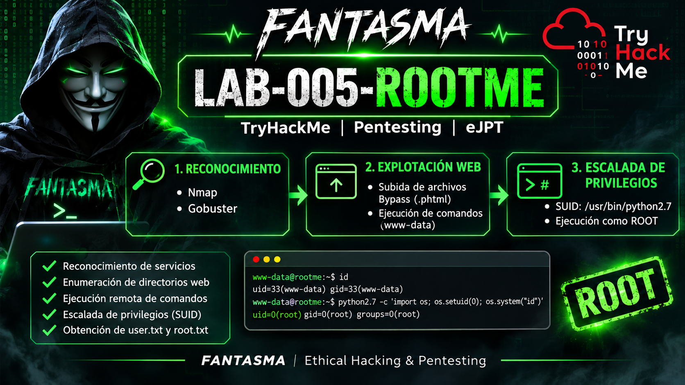

# LAB-005-ROOTME | TryHackMe

**Autor:** FANTASMA  
**Plataforma:** TryHackMe  
**Objetivo:** Formación práctica eJPT  
**Estado:** Completado

## Resumen ejecutivo

Evaluación de seguridad de la máquina RootMe en un entorno de laboratorio autorizado. Se identificó una vulnerabilidad de subida de archivos que permitió ejecutar comandos con los permisos del servicio web. Posteriormente, una configuración insegura de SUID en Python permitió elevar privilegios a root.

## Reconocimiento

- 22/TCP: OpenSSH 8.2p1
- 80/TCP: Apache HTTP Server 2.4.41

Evidencia: [Nmap](01-Reconocimiento/nmap-inicial.txt)

## Enumeración web

Mediante Gobuster se identificaron los directorios `/panel` y `/uploads`, entre otros.

Evidencia: [Gobuster](02-Enumeracion-Web/gobuster-inicial.txt)

## Explotación

El formulario de subida rechazaba archivos `.php`, pero aceptaba archivos `.phtml`. Se verificó que el servidor interpretaba el contenido PHP y permitía ejecutar comandos con la identidad `www-data`.

## Escalada de privilegios

Se identificó el ejecutable `/usr/bin/python2.7` con permisos SUID y propietario root. Esta configuración permitió ejecutar comandos con UID 0.

## Resultados

| Objetivo | Resultado |
|---|---|
| Reconocimiento | Completado |
| Enumeración web | Completado |
| Ejecución remota de comandos | Confirmada |
| Acceso como www-data | Confirmado |
| Escalada a root | Confirmada |
| User Flag | Conseguida |
| Root Flag | Conseguida |

Las banderas y los archivos de explotación no se publican.

## Recomendaciones de seguridad

1. Validar extensiones, contenido y tipos de archivo en el servidor.
2. Impedir la ejecución de scripts en directorios de subida.
3. Aplicar el principio de mínimo privilegio.
4. Eliminar permisos SUID innecesarios de los intérpretes.
5. Mantener los componentes actualizados y monitorizar eventos de seguridad.

## Referencias

- [TryHackMe — RootMe](https://tryhackme.com/room/rrootme)
- [GTFOBins — Python](https://gtfobins.github.io/gtfobins/python/)

---

**FANTASMA | Ethical Hacking & Pentesting**

*Práctica realizada exclusivamente en un entorno de laboratorio autorizado.*
